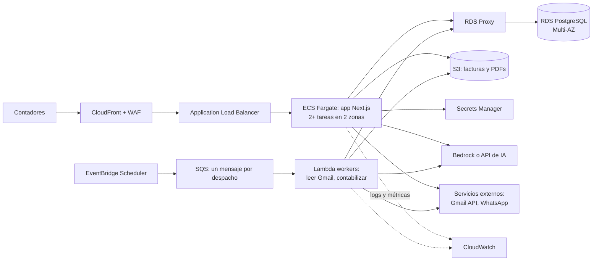

🇬🇧 [English](README.md) · 🇪🇸 Español

# Mi stack en lenguaje AWS: Cont Finance sobre servicios de nube

Ejercicio de arquitectura: tomar una aplicación real que ya está en producción (**Cont Finance**, una plataforma web de contabilidad para contadores de Costa Rica) y **explicarla con los servicios de AWS**: qué equivale a qué, quién es responsable de cada cosa, cómo se lograría alta disponibilidad y qué cambiaría en seguridad y costos.

> **Esto es un análisis, no una migración.** No se creó nada en AWS ni se gastó dinero. Los costos salen de la lista oficial de precios de AWS y se calculan con un script (sección 7).

## 1. Cómo está hoy (resumen)

Cont Finance es una aplicación Next.js (TypeScript) con base de datos PostgreSQL. Hoy corre en proveedores de plataforma (PaaS), no en servidores propios. Tareas programadas: un bot que lee facturas electrónicas del correo y un proceso diario de contabilidad. Se usan modelos de lenguaje por API para leer PDFs y un asistente.

## 2. Equivalencias de servicios

| Necesidad | Hoy | En AWS (opción simple) | En AWS (más control) | Categoría |
|---|---|---|---|---|
| Alojar la app web y las funciones | Vercel (Next.js, funciones serverless) | **AWS Amplify Hosting** (soporta Next.js con renderizado en servidor) | **ECS con Fargate** detrás de un **Application Load Balancer** | Cómputo |
| Base de datos | Neon (PostgreSQL, endpoint con *pooler*) | **Amazon RDS for PostgreSQL** | **Aurora Serverless v2 (PostgreSQL)** | Base de datos |
| Pool de conexiones | PgBouncer de Neon (`-pooler`) | **RDS Proxy** | — | Base de datos |
| Tareas programadas (cron) | Vercel Cron, **límite de 300 s** por corrida | **EventBridge Scheduler → Lambda** (hasta 15 min) | **EventBridge → SQS → varios workers** (una tarea por despacho) | Cómputo / integración |
| Archivos subidos (facturas, PDFs) | Vercel Blob | **Amazon S3** (URLs prefirmadas) + **CloudFront** | — | Almacenamiento |
| Microservicio de Python (llena Excel) | Railway | **AWS Lambda** (imagen de contenedor) | **ECS Fargate** | Cómputo |
| Flujos de automatización (n8n) | Railway | **ECS Fargate** + RDS | EC2 | Cómputo |
| Variables secretas / llaves | Variables de entorno de la plataforma | **AWS Secrets Manager** o **SSM Parameter Store** + **KMS** | — | Seguridad |
| Dominio y certificados | Registrador + Vercel | **Route 53** + **AWS Certificate Manager** | — | Redes |
| Entrega rápida de la web | CDN de Vercel | **CloudFront** | — | Redes / entrega |
| Límites de intentos y bots | En la aplicación (guardados en la base de datos) | **AWS WAF** (reglas por tasa) en el borde, además de los de la aplicación | — | Seguridad |
| Registros y alertas | Logs de Vercel, panel propio de topes | **CloudWatch Logs + Alarms** | — | Monitoreo |
| Auditoría de la cuenta | — | **CloudTrail** | — | Seguridad |
| Modelos de IA (lectura de PDF, asistente) | APIs de proveedores externos | **Amazon Bedrock** (modelos de varios proveedores, facturados en AWS) | seguir con la API directa | IA |
| Correo del cliente (Gmail) y WhatsApp | API de Google / Meta | **No cambia**: son servicios externos | — | Integración |

## 3. Arquitectura propuesta (opción con control)

**Por qué esta forma:** el cuello de botella previsible de la app es la tarea programada que lee los correos de todos los clientes en una sola corrida (con un límite de 300 s por corrida en la plataforma actual). Con **EventBridge + SQS + Lambda**, cada despacho es un mensaje independiente: si uno tarda o falla, se reintenta solo ese mensaje, y el trabajo total ya no depende de un límite de tiempo único.

## 4. Responsabilidad compartida (en esta arquitectura)

| Capa | Responsable |
|---|---|
| Centros de datos, hardware, red física, hipervisor | **AWS** |
| Parches del motor de base de datos y del SO de RDS, Lambda, Fargate (infraestructura) | **AWS** (son servicios administrados) |
| Imagen de contenedor de la app y sus dependencias (Node, librerías) | **Yo** |
| Código de la aplicación y sus vulnerabilidades | **Yo** |
| Permisos IAM, quién puede leer S3 y la base | **Yo** |
| Cifrado de datos (S3, RDS) y manejo de llaves | **Yo** (AWS da las herramientas: KMS) |
| Reglas de WAF y grupos de seguridad | **Yo** |
| Respaldos: activarlos, probar la restauración | **Yo** (AWS los ejecuta) |

Regla práctica: mientras más administrado el servicio (Lambda, S3, RDS), menos es mío. Con EC2 sería mío casi todo.

## 5. Seguridad

- **Usuario raíz** con MFA y sin uso diario; trabajo con **roles de IAM** de **mínimo privilegio**.
- Cada servicio con su propio rol: la app puede leer/escribir en un bucket concreto, no en todos; el worker de Gmail no necesita tocar la facturación.
- **Secretos** (claves de IA, credenciales de Gmail OAuth) en **Secrets Manager**, nunca en el código ni en el repositorio. Los tokens de usuarios cifrados en la base con una llave de **KMS**.
- **Datos sensibles de terceros**: las facturas de clientes de los contadores viven en S3 con *Block Public Access* y cifrado, accesibles solo por URL prefirmada de corta vida.
- **CloudTrail** activado desde el primer día, y **AWS Budgets** con alerta antes de crear nada.
- Multi-tenancy: el aislamiento entre despachos se mantiene en la aplicación (cada consulta filtra por `despacho_id`); en AWS se podría reforzar con *Row Level Security* de PostgreSQL.

## 6. Alta disponibilidad y recuperación

| Riesgo | Mitigación en AWS |
|---|---|
| Cae un centro de datos | App en **2 zonas de disponibilidad**; RDS **Multi-AZ** con conmutación automática |
| Se borra o corrompe la base | Respaldos automáticos de RDS con **recuperación a un punto en el tiempo**; instantánea antes de cada migración |
| Se pierde un archivo | S3 con **versionado** |
| Un despacho con muchas facturas bloquea a los demás | Cola SQS por despacho + *dead-letter queue* para los mensajes que fallan |
| Pico de tráfico | Fargate con escalado por CPU; CloudFront absorbe estáticos |
| Fallo de la región | Fuera de alcance: se documentaría un plan de restauración en otra región con las instantáneas copiadas |

## 7. Costos

Precios **bajo demanda en us-east-1**, tomados de la **lista oficial de precios de AWS** (archivos de la API de listas de precios, publicados entre el 2026-11-20 y el 2026-11-25). El cálculo es reproducible: `python3 cost_estimate.py` (los supuestos están al inicio del script). Los precios cambian con el tiempo; para una cifra vigente conviene repetirlo en la [calculadora de AWS](https://calculator.aws/).

**Escenario pequeño** (1 a pocos despachos, tráfico bajo):

| Servicio | Supuesto | Mensual (USD) |
|---|---|---|
| Fargate (app) | 2 tareas de 0,5 vCPU y 1 GB, 24/7 | 36,04 |
| Application Load Balancer, hora | 1 balanceador | 16,43 |
| Application Load Balancer, capacidad | 1 LCU (supuesto conservador) | 5,84 |
| RDS PostgreSQL Multi-AZ | db.t4g.small | 47,45 |
| RDS almacenamiento | 20 GB gp3 Multi-AZ | 4,60 |
| RDS Proxy | 2 vCPU de la instancia | 21,90 |
| IPv4 públicas | 4 (2 del balanceador, 2 de las tareas) | 14,60 |
| Lambda workers | ~900 invocaciones de 90 s, 1 GB (≈ 81 000 GB-s) | 0,00 (capa gratuita) |
| SQS + EventBridge Scheduler | volumen bajo | 0,00 (capa gratuita) |
| S3 | 5 GB | 0,11 |
| Secrets Manager | 10 secretos | 4,00 |
| KMS | 1 llave | 1,00 |
| CloudWatch Logs | 2 GB al mes, retención 30 días | 1,06 |
| WAF | 1 ACL, 3 reglas, 1 millón de peticiones | 8,60 |
| **Total estimado** | | **≈ 161,63** |

**No incluye:** CloudFront (su tarifa por GB no estaba en la lista consultada), transferencia de datos hacia internet ni impuestos. Hay tarifas con capa gratuita (Lambda, SQS, EventBridge) que dejan esos renglones en cero a este volumen.

**Costo de referencia de las plataformas actuales:** del orden de **USD 40 al mes** (dos suscripciones de plan Pro de USD 20 cada una, más una base de datos en plan gratuito).

**Dónde se va el dinero en AWS:** el 82 % del total son tres costos **fijos que no dependen del tráfico**: la base Multi-AZ con su Proxy (≈ USD 74), el balanceador (≈ USD 22) y Fargate encendido las 24 horas (≈ USD 36). Las IPv4 públicas (USD 14,60) se cobran por hora aunque no haya visitas. Lo que sí es por uso (Lambda, SQS, S3) casi no pesa a este tamaño.

## 8. Conclusión y recomendación

- **Para este tamaño, migrar a AWS no conviene**: la arquitectura propuesta cuesta **≈ USD 162 al mes contra ≈ USD 40** de las plataformas actuales (unas 4 veces más), y además agrega trabajo de operación. La causa son los costos fijos (base Multi-AZ, balanceador, tareas siempre encendidas), no el uso.
- **Se podría bajar** el costo de AWS quitando RDS Proxy y la Multi-AZ en un entorno de pruebas, o usando Lambda en vez de Fargate para la app, pero se perdería parte de la alta disponibilidad: es una decisión de riesgo, no solo de precio.
- **Lo que sí vale la pena tomar prestado** del diseño aun sin migrar: la **cola por despacho** para las tareas programadas, el **versionado y respaldos probados** de archivos y base, y la **separación estricta de secretos y permisos**.
- **Cuándo sí reconsiderar AWS**: si el límite de tiempo de las tareas programadas deja de alcanzar, si hace falta un requisito de cumplimiento o de región específico, o si el volumen vuelve más barato un costo fijo que el precio por uso de las plataformas.

## 9. Revisión con los 6 pilares del Well-Architected Framework

| Pilar | Cómo lo atiende el diseño | Pendiente |
|---|---|---|
| Excelencia operativa | Logs y alarmas en CloudWatch; infraestructura como código (CloudFormation o CDK) | Escribir la plantilla |
| Seguridad | IAM de mínimo privilegio, secretos y llaves administrados, CloudTrail | Revisar con la lista de comprobación de AWS |
| Fiabilidad | Multi-AZ, colas con reintentos, respaldos | Probar una restauración |
| Eficiencia de rendimiento | Caché en CloudFront, pool de conexiones con RDS Proxy | Medir con una prueba de carga |
| Optimización de costos | Escala a cero en los workers; Budgets | Hecho (sección 7); revisar al cambiar los precios |
| Sostenibilidad | Servicios administrados y escalado automático evitan capacidad ociosa | — |

## 10. Experimentos de costo

Se corren con `python3 experiments.py` (mismos precios oficiales de la sección 7, región us-east-1, bajo demanda):

| Caso | Total mensual (USD) | Diferencia con la base |
|---|---|---|
| Arquitectura propuesta (base) | 161,63 | 0,00 |
| Sin RDS Proxy | 139,73 | −21,90 |
| Sin Multi-AZ (una sola zona para la base) | 135,24 | −26,39 |
| Sin Proxy y sin Multi-AZ | 113,34 | −48,29 |
| 4 tareas de la app en vez de 2 | 204,97 | +43,34 |

**Lectura:** quitar Proxy y Multi-AZ baja el total unos 30 %, pero **sigue siendo casi el triple** de los ≈ USD 40 de las plataformas actuales, así que la conclusión de no migrar no cambia. Y esa rebaja se paga en disponibilidad: sin Multi-AZ, una caída de la zona de la base deja la aplicación sin datos hasta restaurar. Duplicar las tareas de la app suma unos USD 43 (el cómputo y sus dos direcciones IPv4 públicas).

El script no cubre otra región: los archivos de precios por región tienen la misma estructura, así que repetirlo con otra región es un ejercicio de cambiar la dirección de descarga.
