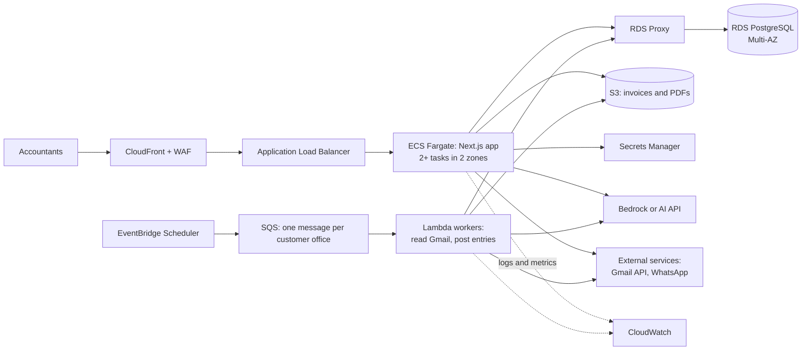

🇬🇧 English · 🇪🇸 [Español](README.es.md)

🎬 **Video walkthrough (English, ~9 min) of all four portfolio projects:** [watch](https://github.com/close-cr/close-cr/blob/main/media/portfolio-walkthrough.mp4)
# My stack in AWS terms: a real web app mapped onto cloud services

An architecture exercise: take an application that is already in production (**Cont Finance**, an accounting web platform for accountants in Costa Rica) and **explain it with AWS services**: what maps to what, who is responsible for each part, how high availability would be achieved, and what would change in security and cost.

> **This is an analysis, not a migration.** Nothing was created in AWS and no money was spent. Costs come from the official AWS price list and are computed with a script (section 7).

## 1. How it works today (summary)

Cont Finance is a Next.js (TypeScript) application with a PostgreSQL database. It runs on platform providers (PaaS), not on servers of its own. Scheduled jobs: a bot that reads electronic invoices from email, and a daily accounting process. Language models are called through APIs to read PDFs and to power an assistant.

## 2. Service equivalences

| Need | Today | On AWS (simple option) | On AWS (more control) | Category |
|---|---|---|---|---|
| Host the web app and functions | Vercel (Next.js, serverless functions) | **AWS Amplify Hosting** (supports server-side rendered Next.js) | **ECS on Fargate** behind an **Application Load Balancer** | Compute |
| Database | Neon (PostgreSQL, pooled endpoint) | **Amazon RDS for PostgreSQL** | **Aurora Serverless v2 (PostgreSQL)** | Database |
| Connection pooling | Neon's PgBouncer (`-pooler`) | **RDS Proxy** | — | Database |
| Scheduled jobs (cron) | Vercel Cron, **300 s limit** per run | **EventBridge Scheduler → Lambda** (up to 15 min) | **EventBridge → SQS → several workers** (one job per customer office) | Compute / integration |
| Uploaded files (invoices, PDFs) | Vercel Blob | **Amazon S3** (presigned URLs) + **CloudFront** | — | Storage |
| Python microservice (fills Excel) | Railway | **AWS Lambda** (container image) | **ECS Fargate** | Compute |
| Automation flows (n8n) | Railway | **ECS Fargate** + RDS | EC2 | Compute |
| Secrets / keys | Platform environment variables | **AWS Secrets Manager** or **SSM Parameter Store** + **KMS** | — | Security |
| Domain and certificates | Registrar + Vercel | **Route 53** + **AWS Certificate Manager** | — | Networking |
| Fast delivery of the site | Vercel CDN | **CloudFront** | — | Networking / delivery |
| Rate limits and bots | In the application (stored in the database) | **AWS WAF** (rate-based rules) at the edge, on top of the app's own limits | — | Security |
| Logs and alerts | Vercel logs, in-house limits panel | **CloudWatch Logs + Alarms** | — | Monitoring |
| Account audit | — | **CloudTrail** | — | Security |
| AI models (PDF reading, assistant) | External provider APIs | **Amazon Bedrock** (models from several providers, billed in AWS) | keep the direct API | AI |
| Customer email (Gmail) and WhatsApp | Google / Meta APIs | **No change**: external services | — | Integration |

## 3. Proposed architecture (the "more control" option)

**Why this shape:** the foreseeable bottleneck of the app is the scheduled task that reads every customer's email in a single run (300 s per run on the current platform). With **EventBridge + SQS + Lambda**, each customer office is an independent message: if one is slow or fails, only that message is retried, and total throughput no longer depends on one single time limit.

## 4. Shared responsibility (in this architecture)

| Layer | Responsible |
|---|---|
| Data centers, hardware, physical network, hypervisor | **AWS** |
| Patching the database engine and OS of RDS, Lambda, Fargate (infrastructure) | **AWS** (managed services) |
| The app's container image and its dependencies (Node, libraries) | **Me** |
| Application code and its vulnerabilities | **Me** |
| IAM permissions, who can read S3 and the database | **Me** |
| Data encryption (S3, RDS) and key management | **Me** (AWS provides the tools: KMS) |
| WAF rules and security groups | **Me** |
| Backups: enabling them and testing the restore | **Me** (AWS runs them) |

Rule of thumb: the more managed the service (Lambda, S3, RDS), the less is mine. With EC2 almost everything would be mine.

## 5. Security

- **Root user** with MFA and no daily use; day-to-day work with **least-privilege IAM roles**.
- Each service gets its own role: the app can read and write a specific bucket, not all of them; the Gmail worker does not need to touch billing.
- **Secrets** (AI keys, Gmail OAuth credentials) in **Secrets Manager**, never in code or in the repository. User tokens encrypted in the database with a **KMS** key.
- **Third-party sensitive data**: customers' invoices live in S3 with *Block Public Access* and encryption, reachable only through short-lived presigned URLs.
- **CloudTrail** on from day one, and an **AWS Budgets** alert before creating anything.
- Multi-tenancy: isolation between customer offices stays in the application (every query filters by `office_id`); on AWS it could be reinforced with PostgreSQL *Row Level Security*.

## 6. High availability and recovery

| Risk | Mitigation on AWS |
|---|---|
| A data center goes down | App in **2 availability zones**; **Multi-AZ** RDS with automatic failover |
| The database is deleted or corrupted | Automatic RDS backups with **point-in-time recovery**; a snapshot before every migration |
| A file is lost | S3 with **versioning** |
| One customer office with many invoices blocks the others | One SQS message per office + a *dead-letter queue* for messages that fail |
| Traffic spike | Fargate autoscaling on CPU; CloudFront absorbs static content |
| Region failure | Out of scope: a restore plan in another region with copied snapshots would be documented |

## 7. Costs

Prices are **on-demand in us-east-1**, taken from the **official AWS price list** (Price List API files published between 2026-11-20 and 2026-11-25). The calculation is reproducible: `python3 cost_estimate.py` (assumptions are at the top of the script). Prices change over time; for a current figure, repeat it in the [AWS calculator](https://calculator.aws/).

**Small scenario** (one to a few customer offices, low traffic):

| Service | Assumption | Monthly (USD) |
|---|---|---|
| Fargate (app) | 2 tasks of 0.5 vCPU and 1 GB, 24/7 | 36.04 |
| Application Load Balancer, hours | 1 load balancer | 16.43 |
| Application Load Balancer, capacity | 1 LCU (conservative assumption) | 5.84 |
| RDS PostgreSQL Multi-AZ | db.t4g.small | 47.45 |
| RDS storage | 20 GB gp3 Multi-AZ | 4.60 |
| RDS Proxy | 2 vCPU of the instance | 21.90 |
| Public IPv4 addresses | 4 (2 on the load balancer, 2 on the tasks) | 14.60 |
| Lambda workers | ~900 invocations of 90 s, 1 GB (≈ 81,000 GB-s) | 0.00 (free tier) |
| SQS + EventBridge Scheduler | low volume | 0.00 (free tier) |
| S3 | 5 GB | 0.11 |
| Secrets Manager | 10 secrets | 4.00 |
| KMS | 1 key | 1.00 |
| CloudWatch Logs | 2 GB a month, 30-day retention | 1.06 |
| WAF | 1 ACL, 3 rules, 1 million requests | 8.60 |
| **Estimated total** | | **≈ 161.63** |

**Not included:** CloudFront (its per-GB rate was not in the price list consulted), data transfer to the internet, and taxes. Some rates have a free tier (Lambda, SQS, EventBridge) that leaves those lines at zero at this volume.

**Reference cost of the current platforms:** around **USD 40 a month** (two USD 20 Pro plan subscriptions plus a free-tier database).

**Where the money goes on AWS:** 82 % of the total is three **fixed costs that do not depend on traffic**: the Multi-AZ database with its Proxy (≈ USD 74), the load balancer (≈ USD 22) and Fargate running 24 hours (≈ USD 36). Public IPv4 addresses (USD 14.60) are billed hourly even with no visitors. What is pay-per-use (Lambda, SQS, S3) barely matters at this size.

## 8. Conclusion and recommendation

- **At this size, migrating to AWS does not pay off**: the proposed architecture costs **≈ USD 162 a month versus ≈ USD 40** on the current platforms (about 4 times more), and it adds operations work. The cause is fixed costs (Multi-AZ database, load balancer, always-on tasks), not usage.
- **It could be cut** by dropping RDS Proxy and Multi-AZ in a test environment, or by using Lambda instead of Fargate for the app, but part of the high availability would be lost: that is a risk decision, not just a price one.
- **What is worth borrowing** from the design even without migrating: the **per-office queue** for scheduled jobs, **versioning and tested backups** for files and database, and **strict separation of secrets and permissions**.
- **When to reconsider AWS**: if the time limit of scheduled jobs stops being enough, if a specific compliance or region requirement appears, or if volume makes a fixed cost cheaper than the platforms' pay-per-use price.

## 9. Review against the 6 Well-Architected pillars

| Pillar | How the design addresses it | Pending |
|---|---|---|
| Operational excellence | Logs and alarms in CloudWatch; infrastructure as code (CloudFormation or CDK) | Write the template |
| Security | Least-privilege IAM, managed secrets and keys, CloudTrail | Review against the AWS checklist |
| Reliability | Multi-AZ, queues with retries, backups | Test a restore |
| Performance efficiency | CloudFront caching, connection pooling with RDS Proxy | Measure with a load test |
| Cost optimization | Workers scale to zero; Budgets | Done (section 7); review when prices change |
| Sustainability | Managed services and autoscaling avoid idle capacity | — |

## 10. Cost experiments

Run with `python3 experiments.py` (same official prices as section 7, us-east-1, on-demand):

| Case | Monthly total (USD) | Difference from baseline |
|---|---|---|
| Proposed architecture (baseline) | 161.63 | 0.00 |
| Without RDS Proxy | 139.73 | −21.90 |
| Without Multi-AZ (single zone for the database) | 135.24 | −26.39 |
| Without Proxy and without Multi-AZ | 113.34 | −48.29 |
| 4 app tasks instead of 2 | 204.97 | +43.34 |

**Reading:** removing Proxy and Multi-AZ lowers the total by about 30 %, but it is **still almost three times** the ≈ USD 40 of the current platforms, so the "do not migrate" conclusion does not change. And that saving is paid for in availability: without Multi-AZ, losing the database's zone leaves the application without data until a restore. Doubling the app's tasks adds about USD 43 (compute plus its two public IPv4 addresses).

The script does not cover another region: the regional price files have the same structure, so repeating it for another region is just a matter of changing the download address.
